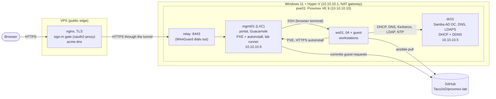

# Linux workstation provisioning lab

A small, self-contained lab that provisions Linux workstations end to end, the way a
studio IT team might: network boot, unattended install, Active Directory join without
admin credentials, role-based configuration from AD, and DHCP-driven DNS. Reimaging a
workstation is one command, and nobody types or sees a secret along the way.

On top of that sits a **self-service portal**: a visitor picks a username and a role,
watches the lab build their workstation from scratch (about eight minutes), and opens a
terminal on it in the browser. Lab admins can select any workstations, fleet or guest, on
the portal's admin page and delete them together; each deletion removes every trace: VM,
AD accounts, DHCP, DNS and records. The lab's own machines aren't listed there.

It runs nested on a single Windows 11 PC: Hyper-V → Proxmox VE → the lab VMs. A small
VPS is its public front door; the lab itself accepts no inbound connections.

## What it does

```text
lab reimage ws03                                    (one command, on the mgmt01 runner)
 ├─ Ansible        AD account + role, DHCP reservation, autoinstall record (from inventory/)
 ├─ Ansible        fresh one-time AD join password (served only to ws03's IP)
 └─ OpenTofu       replace ws03's VM: new blank disk, boot
                     │
     UEFI PXE ──► shim ──► GRUB ──► Ubuntu autoinstall (unattended, records over HTTPS)
                     │
     first boot: ansible-pull from this GitHub repo (ansible/)
        base      time from the DC, packages, self-scheduling ansible-pull timer
        ad_join   join AD with the one-time password (then delete it), Kerberos, SSSD
        roles     ask AD "which role-* groups is my computer account in?" → apply them
                     │
     DHCP on dc01 registers ws03 in AD DNS (A + PTR); clients never write DNS
```

After that the machine pulls its configuration from git every ~30 minutes and corrects
any drift. Changing a machine's role or adding a machine is a line in
`inventory/workstations.yml` plus `lab apply`; changing policy is a git push. The portal
uses exactly the same path: each request becomes one file in `inventory/guests/`,
committed to git, then `lab apply` (see [docs/self-service.md](docs/self-service.md)).

## Architecture



| Host | What | Notes |
|---|---|---|
| `dc01` | Samba AD DC (`AD.LAB.INTERNAL`), DNS, dnsmasq DHCP | RFC2307 Unix IDs in AD; reverse zone; DHCP registers clients in DNS; LDAPS with a Let's Encrypt certificate |
| `mgmt01` | Unprivileged LXC: tftpd-hpa, nginx, the `lab` runner, the portal, Apache Guacamole (Docker) | Signed shim + GRUB for Secure Boot PXE; per-host autoinstall records; runs OpenTofu and Ansible |
| `pve01` | Proxmox VE, nested in Hyper-V | VMs managed through its API by OpenTofu (`terraform@pve`, not root); dials the WireGuard tunnel to the VPS |
| `ws01..04` | Ubuntu 26.04 workstations | Joined to AD, self-managing via `ansible-pull` |
| guest `ws-<user>` | Workstations built through the portal | One owner each; up to four at a time |
| VPS | nginx, oauth2-proxy, acme-dns ([vps/](vps/README.md)) | Public names `lab.` and `pve.radicallydecent.com` |

## Design decisions

- **DHCP is the source of truth for addresses; DNS is derived from it.** Reservations
  (MAC → IP → name) are the only place an address is assigned. On every lease, dnsmasq's
  `dhcp-script` sends a Kerberos-signed DNS update (GSS-TSIG) as a dedicated service
  account. Clients have `dyndns_update = False`. In AD DNS the first account to create a
  name owns it, so a single writer avoids records nobody else can update. Reserved hosts
  keep their records when a lease lapses (the Infoblox "host record" model); removing a
  machine releases its lease, so its records go at once.
- **AD join without admin credentials.** Computer accounts are pre-staged in
  `OU=Workstations`. Provisioning sets a random one-time password on the account; the
  machine uses it once (`adcli join --one-time-password`), immediately replaces it with
  its own machine password, and deletes the file. nginx serves each host's one-time
  password only to that host's reserved IP.
- **Roles come from AD computer groups.** A machine reads its own `memberOf` over LDAP,
  authenticated with its own keytab (`role-artist` → `roles/artist`). Reimaging keeps
  the role because it lives on the AD account, not on the disk.
- **Authorization is separate from authentication.** Kerberos proves who you are; SSSD's
  `simple` access provider decides whether you may log in *here*. The allowed groups are
  generated from the machine's role (artists on artist machines, programmers on
  programmer machines, `ws-admins` everywhere with sudo). A guest machine admits only its
  owner and `ws-admins`.
- **Pull, not push.** Workstations run `ansible-pull` on a systemd timer with a
  randomized delay, so they converge even if they were off or asleep during a change.
  Runs are serialized with `flock`. Read-only probes are marked `check_mode: false` so
  `--check --diff` gives a trustworthy preview.
- **Same UID everywhere.** RFC2307 attributes (`uidNumber`, `gidNumber`, home, shell) are
  stored in AD and SSSD uses them (`ldap_id_mapping = False`), which is what shared NFS
  storage needs.
- **HTTPS everywhere, with certificates the stock clients already trust.** Every web
  endpoint, including the autoinstall records and one-time passwords the installer
  fetches, uses a Let's Encrypt certificate. The lab is not reachable from the internet,
  so certificates use the DNS-01 check through [acme-dns](vps/README.md) on the VPS: each
  name's acme-dns account can change only its own TXT record, and the registrar's API key
  (which controls the whole domain, mail included) never touches a lab machine. Names
  under `lab.radicallydecent.com` resolve to lab hosts inside the lab (an AD DNS zone),
  so lab machines and visitors use the same names and certificates. The one plain-HTTP
  download left is the Ubuntu ISO, which GRUB and the initramfs fetch before any TLS
  client exists.
- **The lab dials out; nothing dials in.** pve01 keeps a WireGuard tunnel open to the
  VPS. Through it, the VPS may reach only the Proxmox UI and a TCP relay to the portal's
  internet-facing port on mgmt01, which serves the portal and terminal but no install
  records. Every hop is TLS with a verified certificate.

## Repository layout

```text
host-setup/   Hyper-V + Proxmox build scripts (enable Hyper-V, create the nested VM,
              boot the PVE installer on Gen 2, Proxmox post-install)
inventory/    workstations.yml: hand-maintained fleet; guests/: one file per portal request
              (both read by OpenTofu and Ansible)
terraform/    OpenTofu: the workstation VMs
ansible/      local.yml: what workstations pull (base, ad_join, artist, programmer)
              infra.yml, otp.yml: AD accounts, DHCP reservations, autoinstall records
              portal.yml: the portal, Guacamole, certificates, the internal DNS zone
dc01/         dnsmasq base config, the DHCP→DNS update script, Samba's certificate hook
mgmt01/       the `lab` command, the PXE menu, the autoinstall template, the nginx OTP rule
mgmt01/portal/  the portal (web app, worker, pages), its nginx and systemd config
pve01/        the WireGuard tunnel firewall and the portal relay
vps/          the public edge: nginx sites, sign-in gate, acme-dns
docs/         boundaries.md: which tool owns what; self-service.md: how the portal works
```

This repo is the source of truth. Workstations pull `ansible/` straight from GitHub;
the runner on mgmt01 pulls before every `lab` command, and the portal commits each
request here before acting on it.

```text
lab plan              what would change (read-only)
lab apply             make the lab match the inventory
lab reimage <host>    rebuild one workstation (keeps its AD account and role)
lab prune             remove AD accounts, DHCP leases, DNS and records of removed workstations
lab portal            install or update the self-service portal
```

## Things that broke, and why

Most of the learning was here. Each of these is fixed in the code above.

| Symptom | Cause | Fix |
|---|---|---|
| UEFI VM has no network boot option at all | Since the 2024 PixieFail fixes, EDK2's network stack won't start without an entropy source; the default Proxmox CPU type doesn't expose RDRAND | Give VMs a virtio RNG (`--rng0 source=/dev/urandom`) |
| Netboot installer: "No space left on device" even at 7 GB RAM | Ubuntu's `url=` netboot downloads the ISO into the initramfs rootfs, a tmpfs capped at 40% of RAM on this kernel | `initramfs_options=size=90%` on the installer's kernel command line (kernel 7.0+) |
| apt: "Release file is not valid yet" after the host slept | Nested VMs froze with the hypervisor and woke ~5 h behind; chrony's default `makestep 1 3` only steps the clock at startup | `makestep 1 -1` everywhere |
| `ansible-pull` fails to clone | The first in-lab git server was plain nginx ("dumb HTTP"), which can't serve shallow clones | `--full` at first; now the fleet pulls from GitHub, which can |
| DHCP server's DNS updates REFUSED | AD DNS name objects are owned by whoever created them, including empty "tombstoned" ones left by earlier client self-registration | Single writer (the DHCP service account); clients don't register |
| Every Ansible run "changed" sssd.conf and restarted SSSD | `sssd.service` resets `/etc/sssd` to `root:sssd`, group-readable, on every start; the role wrote `0600` | Write `root:sssd 0640`, matching what the service enforces |
| First boot and later runs disagreed about the machine's AD groups | Refreshing local facts mid-play is unreliable in ansible-core 2.20, and the old fact names are deprecated | The role runs the AD lookup directly and stores it in one variable |
| Reimaged VM reinstalled itself 8 times | The first reimage script used `qm disk unlink`, which also removes the disk from the boot order, so the VM kept PXE-booting | The VM definition sets `boot_order = ["scsi0", "net0"]` explicitly |
| Installer: kernel panic, "System is deadlocked on memory" | A ballooning range let Proxmox shrink the VM mid-install; the installer's RAM-held ISO can't be given back | Fixed memory (no balloon range); free page reporting still returns freed memory to the host |
| A reimage held the OpenTofu state lock for 15 minutes | The provider waits up to 15 minutes for the guest agent; an installing or crashed VM has none | `agent.timeout = "30s"`, and `stop_on_destroy` so a crashed VM is powered off instead of waited on |
| Configuration runs failed after an SSH policy change | Ubuntu starts `ssh.service` on demand (`ssh.socket`), so `systemctl reload ssh` fails while it isn't running | `systemctl try-reload-or-restart ssh` |
| The first portal-built machine stopped at "An error occurred" | `lab` found new machines with `comm`, comparing a locale-sorted list with a Python-sorted one; `ws-tester` sorted differently in each, so it never got a one-time password | Byte-order sort (`LC_ALL=C`) for both lists |
| Browser terminal filled with `start=…;machineid=…` on every prompt | systemd's new profile script prints OSC 3008 "context" escape codes, which Guacamole's terminal shows as text | `dpkg-divert` the script on workstations |
| Second "Connect" showed "No recent connections" | Guacamole reused the browser's existing session and ignored the new signed login, whose connection list had expired | The portal signs out the old Guacamole session before each connect |
| 502 from the VPS after turning on upstream certificate checks | nginx's `proxy_ssl_verify_depth` defaults to 1, too short for a Let's Encrypt chain | `proxy_ssl_verify_depth 2` |
| Admin sign-in made the browser ask for the demo password again | Behind HTTP Basic auth, a 401 from the app makes browsers discard the cached credentials | The app answers 403, never 401 (Basic auth was later replaced by a sign-in page) |
| Admin sign-in failed: "Missing Authority Key Identifier" | Python 3.13+ checks certificates strictly, and Samba's auto-generated LDAPS certificate lacks that extension | A Let's Encrypt certificate for dc01 (`dc01.lab.radicallydecent.com`) |
| First portal deletion left records behind | `lab prune` matched MAC links by `lnk_source`, which `find` in ansible-core 2.20 no longer returns | Match links by name (each is named after its MAC) |

## What I'd do differently in production

- A real provisioning platform (KACE SDA, MAAS, Foreman) with a service account
  **delegated** rights over `OU=Workstations`, instead of a script with root on the
  hypervisor.
- A private repo (e.g. GitHub Enterprise) with a read-only deploy key delivered at
  provisioning time, and a CI pipeline running `ansible-lint` and Molecule tests before
  changes reach the fleet.
- Image-based deployment (Packer-built images streamed to disk) instead of a live
  installer, which is faster and avoids holding the ISO in RAM.
- At least two domain controllers, and Kea instead of dnsmasq for DHCP.
- NFS home directories and project storage with `sec=krb5`, using the RFC2307 IDs.
- Single sign-on through the company's identity provider (Entra ID, Okta) for the portal
  and the gate, instead of a shared lab access account plus a separate AD sign-in.
- Breached-password screening and MFA in line with NIST SP 800-63B rev. 4, rather than
  password expiry.
