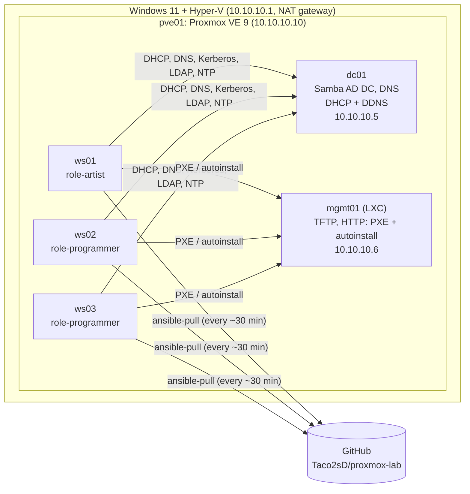

# Linux workstation provisioning lab

A small, self-contained lab that provisions Linux workstations end to end, the way a
studio IT team might: network boot, unattended install, Active Directory join without
admin credentials, role-based configuration from AD, and DHCP-driven DNS. Reimaging a
workstation is one command, and nobody types or sees a secret along the way.

It runs nested on a single Windows 11 PC: Hyper-V → Proxmox VE → the lab VMs.

## What it does

```text
provision-ws ws03                                   (one command on the hypervisor)
 ├─ AD (dc01)      reset the pre-staged computer account to a fresh one-time password
 ├─ mgmt01         write ws03's autoinstall record + one-time password (served only to ws03's IP)
 └─ Proxmox        blank disk, boot
                     │
     UEFI PXE ──► shim ──► GRUB ──► Ubuntu autoinstall (unattended)
                     │
     first boot: ansible-pull from this GitHub repo (ansible/)
        base      time from the DC, packages, self-scheduling ansible-pull timer
        ad_join   join AD with the one-time password (then delete it), Kerberos, SSSD
        roles     ask AD "which role-* groups is my computer account in?" → apply them
                     │
     DHCP on dc01 registers ws03 in AD DNS (A + PTR); clients never write DNS
```

After that the machine pulls its configuration from git every ~30 minutes and corrects
any drift. Changing a machine's role is an AD group change; changing policy is a git push.

## Architecture



| Host | What | Notes |
|---|---|---|
| `dc01` | Samba AD DC (`AD.LAB.INTERNAL`), DNS, dnsmasq DHCP | RFC2307 Unix IDs in AD; reverse zone; DHCP registers clients in DNS |
| `mgmt01` | Unprivileged LXC: tftpd-hpa, nginx | Signed shim + GRUB for Secure Boot PXE; per-host autoinstall records |
| `pve01` | Proxmox VE, nested in Hyper-V | `provision-ws` lives here |
| `ws01..03` | Ubuntu 26.04 workstations | Joined to AD, self-managing via `ansible-pull` |

## Design decisions

- **DHCP is the source of truth for addresses; DNS is derived from it.** Reservations
  (MAC → IP → name) are the only place an address is assigned. On every lease, dnsmasq's
  `dhcp-script` sends a Kerberos-signed DNS update (GSS-TSIG) as a dedicated service
  account. Clients have `dyndns_update = False`. In AD DNS the first account to create a
  name owns it, so a single writer avoids records nobody else can update. Reserved hosts
  keep their records when a lease lapses (the Infoblox "host record" model).
- **AD join without admin credentials.** Computer accounts are pre-staged in
  `OU=Workstations`. Provisioning sets a random one-time password on the account; the
  machine uses it once (`adcli join --one-time-password`), immediately replaces it with
  its own machine password, and deletes the file. nginx serves each host's one-time
  password only to that host's reserved IP.
- **Roles come from AD computer groups.** A machine reads its own `memberOf` over LDAP,
  authenticated with its own keytab (`role-artist` → `roles/artist`). Reimaging keeps
  the role because it lives on the AD account, not on the disk.
- **Authorization is separate from authentication.** Kerberos proves who you are; SSSD's
  `simple` access provider decides whether you may log in *here*. The allowed groups are
  generated from the machine's role (artists on artist machines, programmers on
  programmer machines, `ws-admins` everywhere with sudo).
- **Pull, not push.** Workstations run `ansible-pull` on a systemd timer with a
  randomized delay, so they converge even if they were off or asleep during a change.
  Runs are serialized with `flock`. Read-only probes are marked `check_mode: false` so
  `--check --diff` gives a trustworthy preview.
- **Same UID everywhere.** RFC2307 attributes (`uidNumber`, `gidNumber`, home, shell) are
  stored in AD and SSSD uses them (`ldap_id_mapping = False`), which is what shared NFS
  storage needs.

## Repository layout

```text
host-setup/   Hyper-V + Proxmox build scripts (enable Hyper-V, create the nested VM,
              boot the PVE installer on Gen 2, Proxmox post-install)
dc01/         dnsmasq DHCP config and the DHCP→DNS update script
mgmt01/       autoinstall template and the nginx rule that guards one-time passwords
pve01/        provision-ws: hands-off (re)imaging
ansible/      the configuration the workstations pull (base, ad_join, artist, programmer)
```

This repo is the source of truth. Workstations pull `ansible/` straight from GitHub, and
`provision-ws` fetches the autoinstall template from here for every build, so a push
reaches the whole fleet within about 30 minutes.

## Things that broke, and why

Most of the learning was here. Each of these is fixed in the code above.

| Symptom | Cause | Fix |
|---|---|---|
| UEFI VM has no network boot option at all | Since the 2024 PixieFail fixes, EDK2's network stack won't start without an entropy source; the default Proxmox CPU type doesn't expose RDRAND | Give VMs a virtio RNG (`--rng0 source=/dev/urandom`) |
| Netboot installer: "No space left on device" even at 7 GB RAM | Ubuntu's `url=` netboot downloads the ISO into the initramfs rootfs, a tmpfs capped at 40% of RAM on this kernel | `initramfs_options=size=90%` on the installer's kernel command line (kernel 7.0+) |
| apt: "Release file is not valid yet" after the host slept | Nested VMs froze with the hypervisor and woke ~5 h behind; chrony's default `makestep 1 3` only steps the clock at startup | `makestep 1 -1` everywhere |
| `ansible-pull` fails to clone | The first in-lab git server was plain nginx ("dumb HTTP"), which can't serve shallow clones | `--full` at first; now the fleet pulls from GitHub, which can |
| DHCP server's DNS updates REFUSED | AD DNS name objects are owned by whoever created them, including empty "tombstoned" ones left by earlier client self-registration | Single writer (the DHCP service account); clients don't register |
| Every Ansible run "changed" sssd.conf and restarted SSSD | `sssd.service` resets `/etc/sssd` to `root:sssd`, group-readable, on every start; the role wrote `0600` | Write `root:sssd 0640`, matching what the service enforces |
| First boot and later runs disagreed about the machine's AD groups | Refreshing local facts mid-play is unreliable in ansible-core 2.20, and the old fact names are deprecated | The role runs the AD lookup directly and stores it in one variable |
| Reimaged VM reinstalled itself 8 times | `qm disk unlink` also removes the disk from the boot order, so the VM kept PXE-booting | `provision-ws` sets `--boot order=scsi0;net0` explicitly |

## What I'd do differently in production

- A real provisioning platform (KACE SDA, MAAS, Foreman) with a service account
  **delegated** rights over `OU=Workstations`, instead of a script with root on the
  hypervisor.
- A private repo (e.g. GitHub Enterprise) with a read-only deploy key delivered at
  provisioning time, and a CI pipeline running `ansible-lint` and Molecule tests before
  changes reach the fleet.
- Image-based deployment (Packer-built images streamed to disk) instead of a live
  installer, which is faster and avoids holding the ISO in RAM.
- At least two domain controllers, and Kea instead of dnsmasq for DHCP.
- NFS home directories and project storage with `sec=krb5`, using the RFC2307 IDs.
- Breached-password screening and MFA in line with NIST SP 800-63B rev. 4, rather than
  password expiry.
