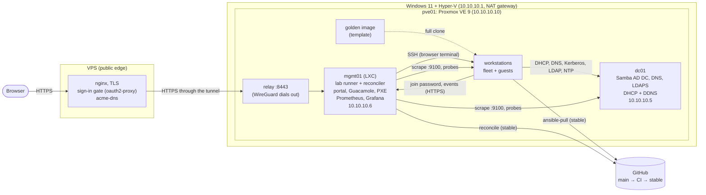

# Linux workstation provisioning lab

A small, self-contained lab that provisions Linux workstations end to end, the way a
studio IT team might: golden images built by network install, Active Directory join
without admin credentials, role-based configuration from AD, DHCP-driven DNS, and a git
repository that the lab follows on its own once a change passes CI. Nobody types or
sees a secret along the way.

On top of that sits a **self-service portal**: a visitor picks a username and a role,
watches the lab build their workstation (a few minutes), and opens a terminal on it in
the browser. Lab admins see every workstation on the portal's admin page, delete any of
them with a full clean-up, and see everything the lab did in its Activity log.

It runs nested on a single Windows 11 PC: Hyper-V → Proxmox VE → the lab VMs. A small
VPS is its public front door; the lab itself accepts no inbound connections.

## How a workstation comes to exist

```text
inventory/workstations/<host>.yml  or   the portal's "New workstation"
 (fleet: a commit to git)               (guest: a record on mgmt01, not git)
        │                                         │
        └──────────────► lab (on mgmt01) ◄────────┘
 ├─ Ansible    AD computer account in role-<role> (+ owner, for guests), DHCP reservation,
 │             one-time AD join password served only to the machine's reserved address
 └─ OpenTofu   full clone of the golden image + a cloud-init drive (hostname, DHCP, key)
                     │
     first boot: lab-firstboot fetches the join password, runs ansible-pull (this repo)
        base      time from the DC, packages, ansible-pull every 30 minutes
        ad_join   join AD with the one-time password (then it's worthless), Kerberos, SSSD
        role      ask AD "which role-* groups is my computer account in?" → catalog/<role>.yml
                     │
     DHCP on dc01 registers the machine in AD DNS (A + PTR); clients never write DNS
```

The golden image itself comes from the network-install pipeline: `lab image build`
PXE-boots a builder VM (UEFI → shim → GRUB → Ubuntu autoinstall over HTTPS), lets it
generalise itself, and turns it into a Proxmox template. A bare-metal machine could take
the same path.

## How changes reach the lab

```text
push to main ──► GitHub Actions: tools/check (lint, tests, inventory rules, OpenTofu) ──► stable
                                                                                         │
            mgmt01: lab-reconcile.timer, every minute ◄──────────────────────────────────┤
              deploy the servers (ansible/site.yml), apply the fleet (lab apply);        │
              destroying a machine waits for an admin's approval                         │
            workstations: ansible-pull every 30 minutes ◄────────────────────────────────┘
```

The lab only ever runs commits that passed their checks, and nothing on the internet
can push into it: it pulls. Operations (builds, deletes, reconciles) are logged on
mgmt01 and shown on the admin page; git holds only code and the fleet, not visitors.

## Architecture



| Host | What | Notes |
|---|---|---|
| `dc01` | Samba AD DC (`AD.LAB.INTERNAL`), DNS, dnsmasq DHCP | RFC2307 Unix IDs in AD; DHCP registers clients in DNS; LDAPS with a Let's Encrypt certificate |
| `mgmt01` | Unprivileged LXC: the `lab` runner and reconciler, nginx, the portal, Apache Guacamole and Prometheus + Grafana (Docker), TFTP | Runs OpenTofu and Ansible; Secure Boot PXE (signed shim + GRUB) for image builds |
| `pve01` | Proxmox VE, nested in Hyper-V | VMs managed through its API (`terraform@pve`, not root); dials the WireGuard tunnel to the VPS; nightly backups of dc01 and mgmt01 |
| fleet | Long-lived workstations, one file each in `inventory/workstations/` | Changed through git |
| guests `ws-<user>` | Workstations built through the portal | One owner each, up to four; runtime records on mgmt01 |
| VPS | nginx, oauth2-proxy, acme-dns ([vps/](vps/README.md)) | Public names `lab.` and `pve.radicallydecent.com` |

## Design decisions

- **Two tiers: code in git, instances in a control plane.** The fleet is long-lived and
  managed by people, so it's GitOps: one file per machine, reviewed and checked like
  code. Portal machines are short-lived and requested by visitors, so they're runtime
  records on mgmt01 with their own OpenTofu state each, the model Microsoft Dev Box and
  Coder use. Visitors' names never enter a public repository, and builds don't wait for
  each other. Both tiers share one VM module, one identity playbook and one catalogue.
- **Golden image, cloned.** Workstations are full clones of a template, not installs:
  a build takes minutes and needs no installer RAM. The PXE/autoinstall pipeline stays,
  as the factory that makes the image (and the path a physical machine would take).
- **The lab pulls; CI gates.** GitHub Actions runs the checks on GitHub's runners and
  moves a `stable` branch; mgmt01 and the workstations follow `stable`. No self-hosted
  runner (on a public repository, fork pull requests could run code on it), no inbound
  webhooks. The reconciler builds and updates by itself; destroying a machine needs an
  admin's approval, and an admin's delete on the admin page is one.
- **DHCP is the source of truth for addresses; DNS is derived from it.** Reservations
  (MAC → IP → name) are the only place an address is assigned, one file per machine.
  On every lease, dnsmasq's `dhcp-script` sends a Kerberos-signed DNS update (GSS-TSIG)
  as a dedicated service account; clients have `dyndns_update = False`. Reserved hosts
  keep their records when a lease lapses (the Infoblox "host record" model); removing a
  machine releases its lease, so its records go at once.
- **AD join without admin credentials.** Computer accounts are pre-staged. Provisioning
  sets a random one-time password on the account; nginx serves it only to the machine's
  reserved address; the machine joins with it once (`adcli join --one-time-password`),
  which replaces it with its own machine password.
- **AD says what a machine is.** A machine reads its own `memberOf` and `managedBy` over
  LDAP with its own keytab: its `role-*` groups pick entries from `catalog/`, and a
  guest machine's owner is its `managedBy`. Rebuilding keeps both: they live on the AD
  account, not the disk.
- **Authorization is separate from authentication.** Kerberos proves who you are; SSSD's
  `simple` access provider decides whether you may log in *here*: a fleet machine admits
  its role's groups (from the catalogue), a guest machine only its owner, and
  `ws-admins` may log in everywhere, with sudo.
- **One fact, one place.** Addresses, names and limits are in
  `ansible/group_vars/all.yml`, read by Ansible, OpenTofu and Python alike. A
  workstation's VM ID decides its IP and MAC, and `tools/validate_inventory.py` enforces
  it. Comments name the files they relate to, and `tools/check_references.py` fails CI
  when one of those paths stops existing.
- **HTTPS everywhere, with certificates the stock clients already trust.** The lab isn't
  reachable from the internet, so every certificate uses the DNS-01 check through
  [acme-dns](vps/README.md) on the VPS: each name's account can change only its own TXT
  record, and the registrar's API key never touches a lab machine. Inside the lab, AD DNS
  answers the public names with lab addresses. The one plain-HTTP download left is the
  installer ISO, which GRUB fetches before any TLS client exists.
- **The lab dials out; nothing dials in.** pve01 keeps a WireGuard tunnel open to the
  VPS, which may reach only the Proxmox UI and a relay to the portal's internet-facing
  port. Every hop is TLS with a verified certificate.
- **Monitoring follows the machines.** Prometheus scrapes node_exporter on every
  machine, Proxmox's API and probes of each service; its workstation targets are
  written from the lab's own records, so machines join and leave the dashboards as
  they're built, hibernated and deleted. Alert rules cover what someone would act on,
  including the lab's own automation ([docs/monitoring.md](docs/monitoring.md)).

## Repository layout

```text
catalog/        workstation definitions (artist, programmer): size, packages, who may log in
inventory/      workstations/: the fleet, one file per machine
terraform/      OpenTofu: modules/workstation (the VM), fleet/ and guest/ (the two tiers)
ansible/        local.yml: what workstations apply to themselves (ansible-pull)
                site.yml: the servers' own configuration (lab deploy, the reconciler)
                identity.yml: AD accounts, DHCP reservations, join passwords (run by lab)
                bootstrap.yml: the automation account, once per server
                group_vars/all.yml: the lab's settings; roles/: everything above
vps/            the public edge: nginx sites, sign-in gate, acme-dns (configured by hand)
host-setup/     Hyper-V + Proxmox build scripts
tools/          check: every check CI runs; the inventory and reference checkers
tests/          unit tests for the Python
docs/           operations.md (runbook), self-service.md, monitoring.md, boundaries.md,
                lessons.md, CONTRIBUTING.md; kb/: the knowledge base (problems, patterns,
                runbooks, plans, component map)
```

The `lab` command on mgmt01 is the one way in: `lab status`, `lab doctor`, `lab plan`,
`lab apply`, `lab reimage <host>`, `lab image build`, `lab deploy`. See
[docs/operations.md](docs/operations.md).

What went wrong while building this, and why, is in [docs/lessons.md](docs/lessons.md); every
problem found and fixed since, with its pattern and runbook, is in the
[knowledge base](docs/kb/README.md) ([index](docs/kb/INDEX.md)).

## What I'd do differently in production

- A real provisioning platform (MAAS, Foreman) with a service account **delegated**
  rights over `OU=Workstations`, instead of automation with full sudo on the DC.
- Images built by Packer in CI and versioned, rather than on the runner.
- A private repository, Molecule tests for the roles, and branch protection with
  required checks (here the portal's admin page commits to `main` directly).
- At least two domain controllers, and Kea instead of dnsmasq for DHCP.
- NFS home directories and project storage with `sec=krb5`, using the RFC2307 IDs.
- Single sign-on through the company's identity provider (Entra ID, Okta) for the portal
  and the gate, instead of a shared lab access account plus a separate AD sign-in.
- Alertmanager routing alerts to an on-call rotation, Loki for logs next to the
  metrics, and Prometheus running somewhere other than the machine it watches.
- Breached-password screening and MFA in line with NIST SP 800-63B rev. 4, rather than
  password expiry.
