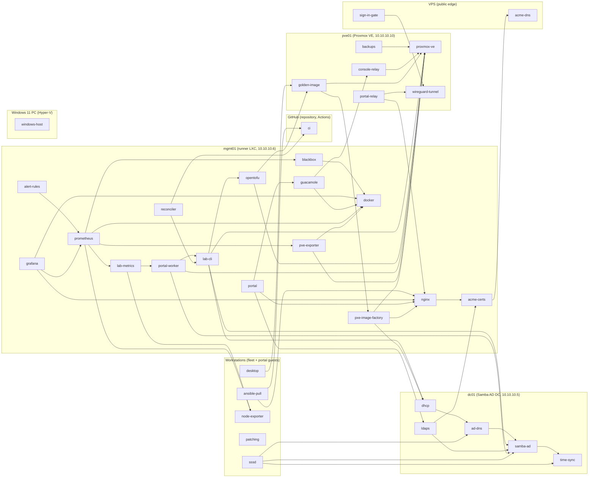

# Knowledge base index

Generated by `python3 tools/kb.py build` from the pages in this folder: don't edit by hand.
How the knowledge base works: [README.md](README.md). Everything below, as data: [kb.json](kb.json).

**57 issues** (2 open or accepted), **23 patterns**, **20 runbooks**, **0 plans**, **42 components**.

## Tallies

### How problems were found

| | Issues | Meaning |
|---|---|---|
| monitoring | 7 | an alert or dashboard of the monitoring stack surfaced it |
| build | 41 | hit while building or changing something |
| investigation | 5 | noticed incidentally while investigating something else |
| user | 1 | a person reported it |
| ci | 3 | the checks (tools/check) caught it |

### Status

| | Issues |
|---|---|
| fixed | 54 |
| mitigated | 1 |
| open | 1 |
| accepted | 1 |

### Severity

| | Issues |
|---|---|
| high | 15 |
| medium | 26 |
| low | 16 |

### Hosts

| | Issues |
|---|---|
| dc01 | 6 |
| github | 3 |
| mgmt01 | 31 |
| pve01 | 17 |
| vps | 3 |
| windows-host | 2 |
| workstations | 18 |

## Open and accepted

Known problems that aren't fixed: accepted ones were judged not worth fixing (the page says why).

| Issue | Problem | Status | Severity | Found by | Hosts |
|---|---|---|---|---|---|
| [KB-0013](issues/KB-0013-stale-browser-tabs.md) | Forgotten browser tabs keep polling the lab all day (a Guacamole desktop and an old Proxmox UI) | open | low | investigation | pve01, mgmt01 |
| [KB-0058](issues/KB-0058-rdp-to-gnome-not-servable-through-guacamole.md) | Remote desktop over RDP couldn't serve the GNOME desktop through Guacamole | accepted | medium | investigation | workstations, mgmt01 |

## Found by the monitoring

Problems an alert or dashboard surfaced (`found_by: monitoring`), as opposed to ones hit while building, stumbled on, reported or anticipated: what the monitoring has earned so far.

| Issue | Problem | Signal | Status | Hosts |
|---|---|---|---|---|
| [KB-0001](issues/KB-0001-console-relay-failed-units.md) | Failed lab-console@ units pile up on pve01 while a browser keeps reconnecting to a sleeping machine | SystemdUnitsFailed | fixed | pve01 |
| [KB-0002](issues/KB-0002-sssd-responder-sockets-failed.md) | SSSD's nss, pam and pac responder sockets sat failed on every workstation | SystemdUnitsFailed | fixed | workstations |
| [KB-0003](issues/KB-0003-dc01-wait-online-needs-resolved.md) | dc01's systemd-networkd-wait-online failed at every boot (it asked a disabled systemd-resolved for DNS) | SystemdUnitsFailed | fixed | dc01 |
| [KB-0004](issues/KB-0004-mgmt01-nvmf-autoconnect-in-lxc.md) | nvmf-autoconnect failed at every boot inside mgmt01's container | SystemdUnitsFailed | fixed | mgmt01 |
| [KB-0005](issues/KB-0005-no-automatic-security-updates.md) | mgmt01 and pve01 had no automatic security updates; 76 were waiting on mgmt01 | SecurityUpdatesPending | fixed | mgmt01, pve01, dc01, workstations |
| [KB-0006](issues/KB-0006-operations-alert-counted-resolved-failures.md) | The failed-operations alert kept firing for failures that had already been put right | OperationsFailing | fixed | mgmt01 |
| [KB-0007](issues/KB-0007-per-unit-failed-alert-storm.md) | One alert per failed systemd unit turned one leaking template unit into ~1,700 alerts | 1,670 firing alerts on the Lab overview | fixed | mgmt01, pve01 |

## Where bugs cluster

Patterns and components by number of issues: where to look first, and where a plan pays off.

| Pattern | Issues | |
|---|---|---|
| [upstream-default-changed](patterns/upstream-default-changed.md) | 6 | An upstream release changed behaviour the lab relied on |
| [client-retry-loop](patterns/client-retry-loop.md) | 4 | A client retries forever against something meant to be off |
| [default-doesnt-fit](patterns/default-doesnt-fit.md) | 4 | A default that is reasonable in general is wrong here |
| [browser-session-state](patterns/browser-session-state.md) | 3 | Session state held by a browser or client outlives what it points at |
| [ci-blind-spot](patterns/ci-blind-spot.md) | 3 | CI passes but the deployment fails |
| [ci-environment-mismatch](patterns/ci-environment-mismatch.md) | 3 | CI's environment differs from the lab's |
| [lost-work-on-restart](patterns/lost-work-on-restart.md) | 3 | Work in flight is lost when the process holding it restarts or dies |
| [nested-virtualization-quirks](patterns/nested-virtualization-quirks.md) | 3 | Nested virtualization behaves differently from bare metal |
| [ram-backed-installer-limits](patterns/ram-backed-installer-limits.md) | 3 | Work done inside a RAM-backed installer runs out of memory |
| [ansible-parsing-gotcha](patterns/ansible-parsing-gotcha.md) | 2 | Ansible parses a task differently than it reads |
| [boot-ordering-race](patterns/boot-ordering-race.md) | 2 | A unit runs before what it needs is ready |
| [dashboard-query-shape](patterns/dashboard-query-shape.md) | 2 | A dashboard query returns a shape the panel doesn't expect |
| [two-writers-one-object](patterns/two-writers-one-object.md) | 2 | Two writers fight over one object |
| [alert-cardinality-storm](patterns/alert-cardinality-storm.md) | 1 | One alert per item explodes into hundreds |
| [alert-on-history-not-state](patterns/alert-on-history-not-state.md) | 1 | An alert counts history instead of current state |
| [conflicting-activation-modes](patterns/conflicting-activation-modes.md) | 1 | Two mechanisms start the same thing |
| [container-irrelevant-units](patterns/container-irrelevant-units.md) | 1 | Units that can't work in a container fail there |
| [disk-headroom](patterns/disk-headroom.md) | 1 | Not enough disk for the next change |
| [fresh-host-assumptions](patterns/fresh-host-assumptions.md) | 1 | Code that only ever ran on a host prepared by hand |
| [implicit-dependency-on-disabled-service](patterns/implicit-dependency-on-disabled-service.md) | 1 | A service is turned off on purpose, and something generated or packaged still depends on it |
| [missing-baseline](patterns/missing-baseline.md) | 1 | A host missed something every host should have |
| [per-connection-unit-pileup](patterns/per-connection-unit-pileup.md) | 1 | Per-connection units pile up as failed |
| [stale-single-file-bind-mount](patterns/stale-single-file-bind-mount.md) | 1 | A single-file bind mount keeps serving the old file |

| Component | Issues |
|---|---|
| [portal](#portal) | 10 |
| [lab-cli](#lab-cli) | 8 |
| [guacamole](#guacamole) | 7 |
| [proxmox-ve](#proxmox-ve) | 7 |
| [ansible-pull](#ansible-pull) | 6 |
| [portal-worker](#portal-worker) | 6 |
| [pxe-image-factory](#pxe-image-factory) | 6 |
| [ci](#ci) | 5 |
| [desktop](#desktop) | 5 |
| [grafana](#grafana) | 4 |
| [nginx](#nginx) | 4 |
| [sign-in-gate](#sign-in-gate) | 4 |
| [alert-rules](#alert-rules) | 3 |
| [console-relay](#console-relay) | 3 |
| [golden-image](#golden-image) | 3 |
| [reconciler](#reconciler) | 3 |
| [samba-ad](#samba-ad) | 3 |
| [ad-dns](#ad-dns) | 2 |
| [dhcp](#dhcp) | 2 |
| [docker](#docker) | 2 |
| [mgmt01](#mgmt01) | 2 |
| [opentofu](#opentofu) | 2 |
| [prometheus](#prometheus) | 2 |
| [sssd](#sssd) | 2 |
| [acme-certs](#acme-certs) | 1 |
| [blackbox](#blackbox) | 1 |
| [lab-metrics](#lab-metrics) | 1 |
| [ldaps](#ldaps) | 1 |
| [node-exporter](#node-exporter) | 1 |
| [patching](#patching) | 1 |
| [pve-exporter](#pve-exporter) | 1 |
| [pve01](#pve01) | 1 |
| [time-sync](#time-sync) | 1 |
| [workstations](#workstations) | 1 |

## Recent issues

| Issue | Found | Problem | Status | Found by |
|---|---|---|---|---|
| [KB-0062](issues/KB-0062-manual-start-hibernated-at-once.md) | 2026-11-07 | A machine started outside My lab was hibernated as idle within a minute | fixed | build |
| [KB-0061](issues/KB-0061-stale-snapshot-showed-ready-machine-as-off.md) | 2026-11-07 | My lab showed a machine that just became ready or woke up as still off | fixed | build |
| [KB-0060](issues/KB-0060-copy-paste-broken-by-redraw.md) | 2026-11-07 | Copy and paste stopped working on the portal pages | fixed | build |
| [KB-0058](issues/KB-0058-rdp-to-gnome-not-servable-through-guacamole.md) | 2026-11-07 | Remote desktop over RDP couldn't serve the GNOME desktop through Guacamole | accepted | investigation |
| [KB-0057](issues/KB-0057-desktop-dropped-on-resolution-change.md) | 2026-11-07 | Browser desktop dropped whenever the screen resolution changed | fixed | build |
| [KB-0056](issues/KB-0056-guacamole-replayed-spent-console-ticket.md) | 2026-11-07 | Desktop Reconnect never worked: Guacamole replayed a spent one-time console ticket | fixed | build |
| [KB-0055](issues/KB-0055-ansible-pull-unit-used-removed-variable.md) | 2026-11-07 | Workstations' ansible-pull unit referenced a variable removed in the settings rewrite | fixed | build |
| [KB-0054](issues/KB-0054-fresh-host-missing-directories.md) | 2026-11-07 | Playbooks failed on a fresh host: copying into directories that didn't exist yet | fixed | build |
| [KB-0053](issues/KB-0053-ci-scripts-not-executable.md) | 2026-11-07 | CI couldn't run tools/check: scripts weren't executable in git | fixed | ci |
| [KB-0052](issues/KB-0052-ci-unprivileged-lock-directory.md) | 2026-11-07 | Unit tests failed in CI: the lock directory is root-only | fixed | ci |
| [KB-0051](issues/KB-0051-tests-depended-on-live-fleet.md) | 2026-11-07 | Removing ws03 failed CI, so the removal could never be released | fixed | ci |
| [KB-0050](issues/KB-0050-reconcile-failed-file-used-as-filter.md) | 2026-11-07 | Reconciler deploy failed: `file` used as a Jinja filter (it's a lookup) | fixed | build |
| [KB-0049](issues/KB-0049-reconcile-failed-nginx-unquoted-regex.md) | 2026-11-07 | Reconciler deploy failed: nginx rejected an unquoted regex with braces | fixed | build |
| [KB-0048](issues/KB-0048-stale-proxmox-tab-exhausted-rate-limit.md) | 2026-11-07 | Every page of lab. and pve. answered 503 because one stale browser tab used up the rate limit | fixed | build |
| [KB-0047](issues/KB-0047-firstboot-unit-dropped-ordering-cycle.md) | 2026-11-07 | Clones booted fine but never enrolled: systemd dropped the first-boot unit | fixed | build |

## Plans

_None yet._

## Runbooks

One per alert rule (ansible/roles/monitoring/files/alerts.yml).

| Alert | Severity | Past occurrences |
|---|---|---|
| [CertificateExpiresSoon](runbooks/CertificateExpiresSoon.md) | warning | 0 |
| [ClockSkew](runbooks/ClockSkew.md) | warning | 0 |
| [DiskAlmostFull](runbooks/DiskAlmostFull.md) | critical | 0 |
| [DiskFillingUp](runbooks/DiskFillingUp.md) | warning | 0 |
| [GuestMemoryBudgetNearlyUsed](runbooks/GuestMemoryBudgetNearlyUsed.md) | warning | 0 |
| [MemoryLow](runbooks/MemoryLow.md) | warning | 0 |
| [OperationFailureUnresolved](runbooks/OperationFailureUnresolved.md) | warning | 0 |
| [PortalWorkerStale](runbooks/PortalWorkerStale.md) | critical | 0 |
| [RebootRequired](runbooks/RebootRequired.md) | warning | 0 |
| [ReconcilerPaused](runbooks/ReconcilerPaused.md) | warning | 0 |
| [ReconcilerStopped](runbooks/ReconcilerStopped.md) | critical | 0 |
| [ReleaseFailedToApply](runbooks/ReleaseFailedToApply.md) | critical | 0 |
| [SecurityUpdatesPending](runbooks/SecurityUpdatesPending.md) | warning | 1 |
| [ServiceProbeFailed](runbooks/ServiceProbeFailed.md) | critical | 0 |
| [ServiceRestartLoop](runbooks/ServiceRestartLoop.md) | warning | 0 |
| [StoragePoolAlmostFull](runbooks/StoragePoolAlmostFull.md) | warning | 0 |
| [SystemdUnitsFailed](runbooks/SystemdUnitsFailed.md) | warning | 4 |
| [TargetDown](runbooks/TargetDown.md) | critical | 0 |
| [TunnelDown](runbooks/TunnelDown.md) | critical | 0 |
| [WorkstationNotCheckingIn](runbooks/WorkstationNotCheckingIn.md) | warning | 0 |

## Component map

From [components.yml](components.yml): what runs where, and what depends on what (an arrow points at the dependency).

## Components

### acme-certs

**Let's Encrypt certificates** (service, on mgmt01). DNS-01 via acme-dns for lab., pve. and dc01.lab.radicallydecent.com (certbot on mgmt01 and dc01, Proxmox's ACME client on pve01).

Roles: `ansible/roles/acme_cert`, `ansible/roles/samba_ldaps`.
Depends on: [acme-dns](#acme-dns).
Used by: [ldaps](#ldaps), [nginx](#nginx).

| Issue | Problem | Status | Found by |
|---|---|---|---|
| [KB-0040](issues/KB-0040-samba-ldaps-cert-rejected-python-313.md) | Admin sign-in failed over LDAPS: 'Missing Authority Key Identifier' | fixed | build |

### acme-dns

**acme-dns** (service, on vps). Answers the DNS-01 challenges for every lab certificate; each name has its own account.

Roles: `vps/acme-dns.cfg`.
Docs: `vps/README.md`.
Used by: [acme-certs](#acme-certs).

_No issues recorded._

### ad-dns

**AD DNS** (service, on dc01). Samba's DNS for ad.lab.internal, the reverse zone, and lab copies of the public names.

Roles: `ansible/roles/lab_dns`.
Depends on: [samba-ad](#samba-ad).
Used by: [dhcp](#dhcp), [sssd](#sssd).

| Issue | Problem | Status | Found by |
|---|---|---|---|
| [KB-0003](issues/KB-0003-dc01-wait-online-needs-resolved.md) | dc01's systemd-networkd-wait-online failed at every boot (it asked a disabled systemd-resolved for DNS) | fixed | monitoring |
| [KB-0029](issues/KB-0029-ad-dns-updates-refused-stale-dnsnode.md) | The DHCP server's DNS updates were REFUSED for names clients had registered before | fixed | build |

### alert-rules

**Alert rules** (service, on mgmt01). ansible/roles/monitoring/files/alerts.yml; every rule has a runbook in docs/kb/runbooks.

Roles: `ansible/roles/monitoring`.
Docs: `docs/monitoring.md`.
Depends on: [prometheus](#prometheus).

| Issue | Problem | Status | Found by |
|---|---|---|---|
| [KB-0006](issues/KB-0006-operations-alert-counted-resolved-failures.md) | The failed-operations alert kept firing for failures that had already been put right | fixed | monitoring |
| [KB-0007](issues/KB-0007-per-unit-failed-alert-storm.md) | One alert per failed systemd unit turned one leaking template unit into ~1,700 alerts | fixed | monitoring |
| [KB-0008](issues/KB-0008-stale-single-file-bind-mounts.md) | Prometheus kept evaluating old alert rules after a deploy (single-file bind mounts) | fixed | build |

### ansible-pull

**ansible-pull (self-configuration)** (pipeline, on workstations). Every 30 minutes pulls the release branch from GitHub and runs ansible/local.yml; reports to lab-events.

Roles: `ansible/roles/base`, `ansible/roles/workstation_role`.
Docs: `docs/operations.md`.
Depends on: [ci](#ci), [nginx](#nginx).

| Issue | Problem | Status | Found by |
|---|---|---|---|
| [KB-0028](issues/KB-0028-ansible-pull-shallow-clone-dumb-http.md) | ansible-pull couldn't clone from the first in-lab git server | fixed | build |
| [KB-0030](issues/KB-0030-sssd-conf-changed-every-run.md) | Every Ansible run reported sssd.conf changed and restarted SSSD | fixed | build |
| [KB-0031](issues/KB-0031-ad-groups-from-local-facts-unreliable.md) | First boot and later runs disagreed about the machine's AD groups | fixed | build |
| [KB-0034](issues/KB-0034-ssh-reload-fails-socket-activated.md) | Configuration runs failed after an SSH policy change | fixed | build |
| [KB-0036](issues/KB-0036-osc-3008-garbles-browser-terminal.md) | Browser terminal filled with start=...;machineid=... on every prompt | fixed | build |
| [KB-0055](issues/KB-0055-ansible-pull-unit-used-removed-variable.md) | Workstations' ansible-pull unit referenced a variable removed in the settings rewrite | fixed | build |

### backups

**Nightly backups (vzdump)** (service, on pve01). Nightly backups of dc01 and mgmt01.

Roles: `ansible/roles/pve_backups`.
Docs: `docs/operations.md`.
Depends on: [proxmox-ve](#proxmox-ve).

_No issues recorded._

### blackbox

**blackbox_exporter** (service, on mgmt01). Probes the portal, Guacamole, Grafana, Proxmox API, the VPS sign-in page, LDAPS, Kerberos, AD DNS.

Roles: `ansible/roles/monitoring`.
Docs: `docs/monitoring.md`.
Depends on: [docker](#docker).
Used by: [prometheus](#prometheus).

| Issue | Problem | Status | Found by |
|---|---|---|---|
| [KB-0008](issues/KB-0008-stale-single-file-bind-mounts.md) | Prometheus kept evaluating old alert rules after a deploy (single-file bind mounts) | fixed | build |

### ci

**CI (GitHub Actions)** (pipeline, on github). Runs tools/check on every push to main; fast-forwards the release branch (stable) when it passes.

Roles: `.github/workflows/checks.yml`, `tools/check`.
Docs: `docs/CONTRIBUTING.md`.
Used by: [ansible-pull](#ansible-pull), [reconciler](#reconciler).

| Issue | Problem | Status | Found by |
|---|---|---|---|
| [KB-0049](issues/KB-0049-reconcile-failed-nginx-unquoted-regex.md) | Reconciler deploy failed: nginx rejected an unquoted regex with braces | fixed | build |
| [KB-0050](issues/KB-0050-reconcile-failed-file-used-as-filter.md) | Reconciler deploy failed: `file` used as a Jinja filter (it's a lookup) | fixed | build |
| [KB-0051](issues/KB-0051-tests-depended-on-live-fleet.md) | Removing ws03 failed CI, so the removal could never be released | fixed | ci |
| [KB-0052](issues/KB-0052-ci-unprivileged-lock-directory.md) | Unit tests failed in CI: the lock directory is root-only | fixed | ci |
| [KB-0053](issues/KB-0053-ci-scripts-not-executable.md) | CI couldn't run tools/check: scripts weren't executable in git | fixed | ci |

### console-relay

**Console relay (lab-console.socket)** (service, on pve01). Per-connection relay from Guacamole to a guest VM's screen (qm vncproxy), mgmt01 only.

Roles: `ansible/roles/pve_console`.
Docs: `docs/self-service.md`.
Depends on: [proxmox-ve](#proxmox-ve).
Used by: [guacamole](#guacamole).

| Issue | Problem | Status | Found by |
|---|---|---|---|
| [KB-0001](issues/KB-0001-console-relay-failed-units.md) | Failed lab-console@ units pile up on pve01 while a browser keeps reconnecting to a sleeping machine | fixed | monitoring |
| [KB-0013](issues/KB-0013-stale-browser-tabs.md) | Forgotten browser tabs keep polling the lab all day (a Guacamole desktop and an old Proxmox UI) | open | investigation |
| [KB-0056](issues/KB-0056-guacamole-replayed-spent-console-ticket.md) | Desktop Reconnect never worked: Guacamole replayed a spent one-time console ticket | fixed | build |

### dc01

**dc01 (Samba AD DC, 10.10.10.5)** (host, on pve01). The domain controller, AD DNS, DHCP and the lab's time source (VM 105).

Docs: `README.md`.

_No issues recorded._

### desktop

**GNOME desktop** (service, on workstations). Ubuntu Desktop baked into the desktop image; reached as the VM's screen through Guacamole.

Roles: `ansible/roles/desktop`.
Depends on: [golden-image](#golden-image).

| Issue | Problem | Status | Found by |
|---|---|---|---|
| [KB-0023](issues/KB-0023-desktop-install-oom-in-installer.md) | Desktop golden image build hung: the RAM-backed installer ran out of memory | fixed | build |
| [KB-0056](issues/KB-0056-guacamole-replayed-spent-console-ticket.md) | Desktop Reconnect never worked: Guacamole replayed a spent one-time console ticket | fixed | build |
| [KB-0057](issues/KB-0057-desktop-dropped-on-resolution-change.md) | Browser desktop dropped whenever the screen resolution changed | fixed | build |
| [KB-0058](issues/KB-0058-rdp-to-gnome-not-servable-through-guacamole.md) | Remote desktop over RDP couldn't serve the GNOME desktop through Guacamole | accepted | investigation |
| [KB-0059](issues/KB-0059-windows-rdp-nla-reused-wrong-credentials.md) | mstsc logins to GNOME Remote Login failed: 'Could not find user in SAM database' | fixed | investigation |

### dhcp

**DHCP (dnsmasq) and its DNS hook** (service, on dc01). Reservations are the address source of truth; dhcp-dns-update registers A/PTR records over GSS-TSIG.

Roles: `ansible/roles/dhcp_server`, `ansible/roles/dc_identity`.
Depends on: [ad-dns](#ad-dns).
Used by: [lab-cli](#lab-cli), [pxe-image-factory](#pxe-image-factory).

| Issue | Problem | Status | Found by |
|---|---|---|---|
| [KB-0003](issues/KB-0003-dc01-wait-online-needs-resolved.md) | dc01's systemd-networkd-wait-online failed at every boot (it asked a disabled systemd-resolved for DNS) | fixed | monitoring |
| [KB-0029](issues/KB-0029-ad-dns-updates-refused-stale-dnsnode.md) | The DHCP server's DNS updates were REFUSED for names clients had registered before | fixed | build |

### docker

**Docker on mgmt01** (service, on mgmt01). Runs Guacamole and the monitoring stack (needs LXC features nesting=1,keyctl=1).

Roles: `ansible/roles/guacamole`, `ansible/roles/monitoring`.
Used by: [blackbox](#blackbox), [grafana](#grafana), [guacamole](#guacamole), [prometheus](#prometheus), [pve-exporter](#pve-exporter).

| Issue | Problem | Status | Found by |
|---|---|---|---|
| [KB-0008](issues/KB-0008-stale-single-file-bind-mounts.md) | Prometheus kept evaluating old alert rules after a deploy (single-file bind mounts) | fixed | build |
| [KB-0010](issues/KB-0010-mgmt01-disk-too-small-for-monitoring.md) | mgmt01's root disk was too small for the monitoring stack | fixed | build |

### github

**GitHub (repository, Actions)** (host). Source of truth for code; GitHub-hosted runners run the checks.

Docs: `docs/CONTRIBUTING.md`.

_No issues recorded._

### golden-image

**Golden images (templates 9000-9003)** (pipeline, on pve01). Headless and desktop templates, A/B pairs; every workstation is a full clone of one.

Roles: `ansible/roles/pxe`.
Docs: `docs/boundaries.md`.
Depends on: [pxe-image-factory](#pxe-image-factory), [proxmox-ve](#proxmox-ve).
Used by: [desktop](#desktop), [opentofu](#opentofu).

| Issue | Problem | Status | Found by |
|---|---|---|---|
| [KB-0023](issues/KB-0023-desktop-install-oom-in-installer.md) | Desktop golden image build hung: the RAM-backed installer ran out of memory | fixed | build |
| [KB-0046](issues/KB-0046-clones-hung-on-eth0-rename.md) | First clones of the golden image never finished booting | fixed | build |
| [KB-0047](issues/KB-0047-firstboot-unit-dropped-ordering-cycle.md) | Clones booted fine but never enrolled: systemd dropped the first-boot unit | fixed | build |

### grafana

**Grafana** (service, on mgmt01). Lab overview and Machine dashboards from git, anonymous viewers behind the sign-in gate.

Roles: `ansible/roles/monitoring`.
Docs: `docs/monitoring.md`.
Depends on: [prometheus](#prometheus), [nginx](#nginx), [docker](#docker).

| Issue | Problem | Status | Found by |
|---|---|---|---|
| [KB-0007](issues/KB-0007-per-unit-failed-alert-storm.md) | One alert per failed systemd unit turned one leaking template unit into ~1,700 alerts | fixed | monitoring |
| [KB-0009](issues/KB-0009-alert-table-showed-first-series-only.md) | The Lab overview's alert table showed only the first firing alert | fixed | build |
| [KB-0010](issues/KB-0010-mgmt01-disk-too-small-for-monitoring.md) | mgmt01's root disk was too small for the monitoring stack | fixed | build |
| [KB-0012](issues/KB-0012-dashboard-cosmetic-bugs.md) | Dashboard titles were cut off and a no-data text filled empty table cells | fixed | build |

### guacamole

**Apache Guacamole (browser terminal and desktop)** (service, on mgmt01). JSON-auth only; SSH to workstations and VNC through the console relay.

Roles: `ansible/roles/guacamole`.
Docs: `docs/self-service.md`.
Depends on: [docker](#docker), [console-relay](#console-relay).
Used by: [portal](#portal).

| Issue | Problem | Status | Found by |
|---|---|---|---|
| [KB-0001](issues/KB-0001-console-relay-failed-units.md) | Failed lab-console@ units pile up on pve01 while a browser keeps reconnecting to a sleeping machine | fixed | monitoring |
| [KB-0013](issues/KB-0013-stale-browser-tabs.md) | Forgotten browser tabs keep polling the lab all day (a Guacamole desktop and an old Proxmox UI) | open | investigation |
| [KB-0036](issues/KB-0036-osc-3008-garbles-browser-terminal.md) | Browser terminal filled with start=...;machineid=... on every prompt | fixed | build |
| [KB-0037](issues/KB-0037-guacamole-reused-stale-session.md) | A second Connect showed 'No recent connections' instead of the machine | fixed | build |
| [KB-0056](issues/KB-0056-guacamole-replayed-spent-console-ticket.md) | Desktop Reconnect never worked: Guacamole replayed a spent one-time console ticket | fixed | build |
| [KB-0057](issues/KB-0057-desktop-dropped-on-resolution-change.md) | Browser desktop dropped whenever the screen resolution changed | fixed | build |
| [KB-0058](issues/KB-0058-rdp-to-gnome-not-servable-through-guacamole.md) | Remote desktop over RDP couldn't serve the GNOME desktop through Guacamole | accepted | investigation |

### lab-cli

**lab (the runner's command)** (service, on mgmt01). Every change is an operation (plan, apply, reimage, image build, deploy, guest create/delete).

Roles: `ansible/roles/runner`.
Docs: `docs/operations.md`.
Depends on: [opentofu](#opentofu), [samba-ad](#samba-ad), [dhcp](#dhcp), [proxmox-ve](#proxmox-ve).
Used by: [portal-worker](#portal-worker), [reconciler](#reconciler).

| Issue | Problem | Status | Found by |
|---|---|---|---|
| [KB-0006](issues/KB-0006-operations-alert-counted-resolved-failures.md) | The failed-operations alert kept firing for failures that had already been put right | fixed | monitoring |
| [KB-0023](issues/KB-0023-desktop-install-oom-in-installer.md) | Desktop golden image build hung: the RAM-backed installer ran out of memory | fixed | build |
| [KB-0032](issues/KB-0032-qm-disk-unlink-dropped-boot-order.md) | A reimaged VM reinstalled itself eight times | fixed | build |
| [KB-0035](issues/KB-0035-locale-sort-hid-hyphenated-guests.md) | The first portal-built machine never got its one-time password | fixed | build |
| [KB-0041](issues/KB-0041-find-lost-lnk-source-cleanup-incomplete.md) | The first portal deletion left records behind | fixed | build |
| [KB-0042](issues/KB-0042-worker-restart-killed-builds.md) | A worker restart could kill a build halfway | fixed | build |
| [KB-0052](issues/KB-0052-ci-unprivileged-lock-directory.md) | Unit tests failed in CI: the lock directory is root-only | fixed | ci |
| [KB-0054](issues/KB-0054-fresh-host-missing-directories.md) | Playbooks failed on a fresh host: copying into directories that didn't exist yet | fixed | build |

### lab-metrics

**lab-metrics (targets + lab state)** (service, on mgmt01). Writes Prometheus's workstation targets and lab_* metrics from the lab's records every 30 s.

Roles: `ansible/roles/monitoring`.
Docs: `docs/monitoring.md`.
Depends on: [portal-worker](#portal-worker), [node-exporter](#node-exporter).
Used by: [prometheus](#prometheus).

| Issue | Problem | Status | Found by |
|---|---|---|---|
| [KB-0006](issues/KB-0006-operations-alert-counted-resolved-failures.md) | The failed-operations alert kept firing for failures that had already been put right | fixed | monitoring |

### ldaps

**LDAPS (dc01.lab.radicallydecent.com)** (service, on dc01). LDAP over TLS with a Let's Encrypt certificate; the admin page signs people in over it.

Roles: `ansible/roles/samba_ldaps`.
Depends on: [samba-ad](#samba-ad), [acme-certs](#acme-certs).
Used by: [portal](#portal).

| Issue | Problem | Status | Found by |
|---|---|---|---|
| [KB-0040](issues/KB-0040-samba-ldaps-cert-rejected-python-313.md) | Admin sign-in failed over LDAPS: 'Missing Authority Key Identifier' | fixed | build |

### mgmt01

**mgmt01 (runner LXC, 10.10.10.6)** (host, on pve01). Unprivileged LXC 106 running the lab's control plane, web front, image factory and monitoring.

Docs: `README.md`, `docs/operations.md`.

| Issue | Problem | Status | Found by |
|---|---|---|---|
| [KB-0004](issues/KB-0004-mgmt01-nvmf-autoconnect-in-lxc.md) | nvmf-autoconnect failed at every boot inside mgmt01's container | fixed | monitoring |
| [KB-0005](issues/KB-0005-no-automatic-security-updates.md) | mgmt01 and pve01 had no automatic security updates; 76 were waiting on mgmt01 | fixed | monitoring |

### nginx

**nginx on mgmt01** (service, on mgmt01). HTTPS for the lab (443) and the internet via the relay (8443); join passwords, lab-events, the ISO.

Roles: `ansible/roles/lab_web`.
Depends on: [acme-certs](#acme-certs).
Used by: [ansible-pull](#ansible-pull), [grafana](#grafana), [portal](#portal), [portal-relay](#portal-relay), [pxe-image-factory](#pxe-image-factory).

| Issue | Problem | Status | Found by |
|---|---|---|---|
| [KB-0013](issues/KB-0013-stale-browser-tabs.md) | Forgotten browser tabs keep polling the lab all day (a Guacamole desktop and an old Proxmox UI) | open | investigation |
| [KB-0038](issues/KB-0038-vps-502-ssl-verify-depth.md) | The VPS answered 502 after turning on upstream certificate checks | fixed | build |
| [KB-0048](issues/KB-0048-stale-proxmox-tab-exhausted-rate-limit.md) | Every page of lab. and pve. answered 503 because one stale browser tab used up the rate limit | fixed | build |
| [KB-0049](issues/KB-0049-reconcile-failed-nginx-unquoted-regex.md) | Reconciler deploy failed: nginx rejected an unquoted regex with braces | fixed | build |

### node-exporter

**node_exporter** (service, on workstations). On every server and workstation (:9100) with the systemd and apt collectors.

Roles: `ansible/roles/node_exporter`.
Docs: `docs/monitoring.md`.
Used by: [lab-metrics](#lab-metrics), [prometheus](#prometheus).

| Issue | Problem | Status | Found by |
|---|---|---|---|
| [KB-0007](issues/KB-0007-per-unit-failed-alert-storm.md) | One alert per failed systemd unit turned one leaking template unit into ~1,700 alerts | fixed | monitoring |

### opentofu

**OpenTofu (VMs only)** (service, on mgmt01). Creates and destroys workstation VMs; state per tier in /var/lib/lab/tofu.

Roles: `terraform/modules/workstation`, `terraform/fleet`, `terraform/guest`.
Docs: `docs/boundaries.md`.
Depends on: [proxmox-ve](#proxmox-ve), [golden-image](#golden-image).
Used by: [lab-cli](#lab-cli).

| Issue | Problem | Status | Found by |
|---|---|---|---|
| [KB-0022](issues/KB-0022-balloon-shrank-vm-mid-install.md) | Memory ballooning deadlocked the installer: 'System is deadlocked on memory' | fixed | build |
| [KB-0033](issues/KB-0033-opentofu-lock-held-waiting-for-agent.md) | A reimage held the OpenTofu state lock for 15 minutes | fixed | build |

### patching

**Security updates (unattended-upgrades)** (service, on workstations). Automatic security updates on every machine; pending counts show in monitoring.

Roles: `ansible/roles/patching`.

| Issue | Problem | Status | Found by |
|---|---|---|---|
| [KB-0005](issues/KB-0005-no-automatic-security-updates.md) | mgmt01 and pve01 had no automatic security updates; 76 were waiting on mgmt01 | fixed | monitoring |

### portal

**Self-service portal (web side)** (service, on mgmt01). portal.py on 127.0.0.1:8090; welcome page, My lab, admin page, demo mailbox.

Roles: `ansible/roles/portal`.
Docs: `docs/self-service.md`.
Depends on: [nginx](#nginx), [ldaps](#ldaps), [guacamole](#guacamole).

| Issue | Problem | Status | Found by |
|---|---|---|---|
| [KB-0001](issues/KB-0001-console-relay-failed-units.md) | Failed lab-console@ units pile up on pve01 while a browser keeps reconnecting to a sleeping machine | fixed | monitoring |
| [KB-0013](issues/KB-0013-stale-browser-tabs.md) | Forgotten browser tabs keep polling the lab all day (a Guacamole desktop and an old Proxmox UI) | open | investigation |
| [KB-0014](issues/KB-0014-idle-hibernate-after-one-hour.md) | Staff machines hibernated after only one hour without a session | fixed | user |
| [KB-0037](issues/KB-0037-guacamole-reused-stale-session.md) | A second Connect showed 'No recent connections' instead of the machine | fixed | build |
| [KB-0039](issues/KB-0039-401-dropped-basic-auth-credentials.md) | Admin sign-in made the browser ask for the demo password again | fixed | build |
| [KB-0040](issues/KB-0040-samba-ldaps-cert-rejected-python-313.md) | Admin sign-in failed over LDAPS: 'Missing Authority Key Identifier' | fixed | build |
| [KB-0044](issues/KB-0044-handlers-lost-when-play-fails.md) | A failed run dropped notified handlers, so the old code kept running | fixed | build |
| [KB-0045](issues/KB-0045-portal-sandbox-blocked-signups.md) | The portal couldn't save sign-ups: its systemd sandbox made the paths read-only | fixed | build |
| [KB-0060](issues/KB-0060-copy-paste-broken-by-redraw.md) | Copy and paste stopped working on the portal pages | fixed | build |
| [KB-0061](issues/KB-0061-stale-snapshot-showed-ready-machine-as-off.md) | My lab showed a machine that just became ready or woke up as still off | fixed | build |

### portal-relay

**Portal relay (systemd-socket-proxyd)** (service, on pve01). Forwards the tunnel's :8443 to mgmt01's internet-facing nginx server.

Roles: `ansible/roles/portal_relay`.
Depends on: [wireguard-tunnel](#wireguard-tunnel), [nginx](#nginx).

_No issues recorded._

### portal-worker

**Portal worker** (service, on mgmt01). Runs requests as operations, records what Proxmox reports every minute, hibernates idle machines.

Roles: `ansible/roles/portal`.
Docs: `docs/self-service.md`.
Depends on: [lab-cli](#lab-cli), [proxmox-ve](#proxmox-ve), [samba-ad](#samba-ad).
Used by: [lab-metrics](#lab-metrics).

| Issue | Problem | Status | Found by |
|---|---|---|---|
| [KB-0014](issues/KB-0014-idle-hibernate-after-one-hour.md) | Staff machines hibernated after only one hour without a session | fixed | user |
| [KB-0035](issues/KB-0035-locale-sort-hid-hyphenated-guests.md) | The first portal-built machine never got its one-time password | fixed | build |
| [KB-0042](issues/KB-0042-worker-restart-killed-builds.md) | A worker restart could kill a build halfway | fixed | build |
| [KB-0043](issues/KB-0043-operations-stuck-in-progress.md) | Operations whose lab process died stayed 'In progress' forever | fixed | build |
| [KB-0061](issues/KB-0061-stale-snapshot-showed-ready-machine-as-off.md) | My lab showed a machine that just became ready or woke up as still off | fixed | build |
| [KB-0062](issues/KB-0062-manual-start-hibernated-at-once.md) | A machine started outside My lab was hibernated as idle within a minute | fixed | build |

### prometheus

**Prometheus** (service, on mgmt01). Scrapes every 15 s, stores 30 days, evaluates the alert rules; served at /prometheus/.

Roles: `ansible/roles/monitoring`.
Docs: `docs/monitoring.md`.
Depends on: [docker](#docker), [node-exporter](#node-exporter), [pve-exporter](#pve-exporter), [blackbox](#blackbox), [lab-metrics](#lab-metrics).
Used by: [alert-rules](#alert-rules), [grafana](#grafana).

| Issue | Problem | Status | Found by |
|---|---|---|---|
| [KB-0008](issues/KB-0008-stale-single-file-bind-mounts.md) | Prometheus kept evaluating old alert rules after a deploy (single-file bind mounts) | fixed | build |
| [KB-0010](issues/KB-0010-mgmt01-disk-too-small-for-monitoring.md) | mgmt01's root disk was too small for the monitoring stack | fixed | build |

### proxmox-ve

**Proxmox VE (API, VMs, local-lvm)** (service, on pve01). Hypervisor and API on :8006 with a Let's Encrypt certificate; local-lvm thin pool holds every VM disk.

Roles: `host-setup/03-pve-postinstall.sh`.
Docs: `README.md`.
Used by: [backups](#backups), [console-relay](#console-relay), [golden-image](#golden-image), [lab-cli](#lab-cli), [opentofu](#opentofu), [portal-worker](#portal-worker), [pve-exporter](#pve-exporter), [pxe-image-factory](#pxe-image-factory).

| Issue | Problem | Status | Found by |
|---|---|---|---|
| [KB-0010](issues/KB-0010-mgmt01-disk-too-small-for-monitoring.md) | mgmt01's root disk was too small for the monitoring stack | fixed | build |
| [KB-0020](issues/KB-0020-uefi-vm-no-network-boot-without-rng.md) | UEFI VMs show no network boot entry at all | fixed | build |
| [KB-0022](issues/KB-0022-balloon-shrank-vm-mid-install.md) | Memory ballooning deadlocked the installer: 'System is deadlocked on memory' | fixed | build |
| [KB-0024](issues/KB-0024-pve-installer-no-disk-on-hyperv-gen2.md) | Proxmox VE installer finds no ISO and no keyboard on a Hyper-V Gen 2 VM | fixed | build |
| [KB-0025](issues/KB-0025-installer-boot-params-broke-update-grub.md) | Proxmox's installer copied its boot parameters into GRUB's config and broke update-grub | fixed | build |
| [KB-0027](issues/KB-0027-chroot-rbind-stripped-host-cgroups.md) | Leaving a chroot on pve01 unmounted the host's own /sys/fs/cgroup and hung its reboot | fixed | investigation |
| [KB-0032](issues/KB-0032-qm-disk-unlink-dropped-boot-order.md) | A reimaged VM reinstalled itself eight times | fixed | build |

### pve-exporter

**prometheus-pve-exporter** (service, on mgmt01). Proxmox's view of every VM and storage pool, with a read-only token.

Roles: `ansible/roles/monitoring`, `ansible/roles/pve_monitoring`.
Docs: `docs/monitoring.md`.
Depends on: [docker](#docker), [proxmox-ve](#proxmox-ve).
Used by: [prometheus](#prometheus).

| Issue | Problem | Status | Found by |
|---|---|---|---|
| [KB-0011](issues/KB-0011-ansible-free-form-shell-parse-error.md) | A shell task with backslash continuations failed Ansible's argument parsing | fixed | build |

### pve01

**pve01 (Proxmox VE, 10.10.10.10)** (host, on windows-host). Proxmox VE nested in a Hyper-V Gen 2 VM; runs every other lab machine.

Roles: `host-setup/03-pve-postinstall.sh`.
Docs: `README.md`.

| Issue | Problem | Status | Found by |
|---|---|---|---|
| [KB-0005](issues/KB-0005-no-automatic-security-updates.md) | mgmt01 and pve01 had no automatic security updates; 76 were waiting on mgmt01 | fixed | monitoring |

### pxe-image-factory

**PXE image factory** (pipeline, on mgmt01). TFTP (shim + GRUB), autoinstall records and the ISO; lab image build installs builder VM 9009.

Roles: `ansible/roles/pxe`.
Depends on: [dhcp](#dhcp), [nginx](#nginx), [proxmox-ve](#proxmox-ve).
Used by: [golden-image](#golden-image).

| Issue | Problem | Status | Found by |
|---|---|---|---|
| [KB-0020](issues/KB-0020-uefi-vm-no-network-boot-without-rng.md) | UEFI VMs show no network boot entry at all | fixed | build |
| [KB-0021](issues/KB-0021-netboot-installer-tmpfs-full.md) | Ubuntu netboot installer runs out of space even with 7 GB of RAM | fixed | build |
| [KB-0022](issues/KB-0022-balloon-shrank-vm-mid-install.md) | Memory ballooning deadlocked the installer: 'System is deadlocked on memory' | fixed | build |
| [KB-0023](issues/KB-0023-desktop-install-oom-in-installer.md) | Desktop golden image build hung: the RAM-backed installer ran out of memory | fixed | build |
| [KB-0041](issues/KB-0041-find-lost-lnk-source-cleanup-incomplete.md) | The first portal deletion left records behind | fixed | build |
| [KB-0050](issues/KB-0050-reconcile-failed-file-used-as-filter.md) | Reconciler deploy failed: `file` used as a Jinja filter (it's a lookup) | fixed | build |

### reconciler

**Reconciler (lab-reconcile.timer)** (pipeline, on mgmt01). Every minute follows the release branch; deploys site.yml when it moves and every 30 minutes anyway.

Roles: `ansible/roles/runner`.
Docs: `docs/operations.md`.
Depends on: [ci](#ci), [lab-cli](#lab-cli).

| Issue | Problem | Status | Found by |
|---|---|---|---|
| [KB-0044](issues/KB-0044-handlers-lost-when-play-fails.md) | A failed run dropped notified handlers, so the old code kept running | fixed | build |
| [KB-0049](issues/KB-0049-reconcile-failed-nginx-unquoted-regex.md) | Reconciler deploy failed: nginx rejected an unquoted regex with braces | fixed | build |
| [KB-0050](issues/KB-0050-reconcile-failed-file-used-as-filter.md) | Reconciler deploy failed: `file` used as a Jinja filter (it's a lookup) | fixed | build |

### samba-ad

**Samba AD DC (AD.LAB.INTERNAL)** (service, on dc01). Users, computers, groups (teams, role-*), Kerberos KDC; managedBy says who owns a workstation.

Roles: `ansible/roles/dc_identity`, `ansible/roles/ad_people`.
Docs: `docs/boundaries.md`.
Depends on: [time-sync](#time-sync).
Used by: [ad-dns](#ad-dns), [lab-cli](#lab-cli), [ldaps](#ldaps), [portal-worker](#portal-worker), [sssd](#sssd).

| Issue | Problem | Status | Found by |
|---|---|---|---|
| [KB-0003](issues/KB-0003-dc01-wait-online-needs-resolved.md) | dc01's systemd-networkd-wait-online failed at every boot (it asked a disabled systemd-resolved for DNS) | fixed | monitoring |
| [KB-0029](issues/KB-0029-ad-dns-updates-refused-stale-dnsnode.md) | The DHCP server's DNS updates were REFUSED for names clients had registered before | fixed | build |
| [KB-0031](issues/KB-0031-ad-groups-from-local-facts-unreliable.md) | First boot and later runs disagreed about the machine's AD groups | fixed | build |

### sign-in-gate

**Sign-in gate (nginx + oauth2-proxy)** (service, on vps). The lab access account in front of lab. and pve.radicallydecent.com.

Roles: `vps/oauth2-proxy`, `vps/nginx-lab-gate.conf`.
Docs: `vps/README.md`.
Depends on: [wireguard-tunnel](#wireguard-tunnel).

| Issue | Problem | Status | Found by |
|---|---|---|---|
| [KB-0013](issues/KB-0013-stale-browser-tabs.md) | Forgotten browser tabs keep polling the lab all day (a Guacamole desktop and an old Proxmox UI) | open | investigation |
| [KB-0038](issues/KB-0038-vps-502-ssl-verify-depth.md) | The VPS answered 502 after turning on upstream certificate checks | fixed | build |
| [KB-0039](issues/KB-0039-401-dropped-basic-auth-credentials.md) | Admin sign-in made the browser ask for the demo password again | fixed | build |
| [KB-0048](issues/KB-0048-stale-proxmox-tab-exhausted-rate-limit.md) | Every page of lab. and pve. answered 503 because one stale browser tab used up the rate limit | fixed | build |

### sssd

**SSSD (AD logins)** (service, on workstations). Joins with a one-time password, authenticates against AD, admits the owner and login groups.

Roles: `ansible/roles/ad_join`, `ansible/roles/join_otp`.
Depends on: [samba-ad](#samba-ad), [ad-dns](#ad-dns), [time-sync](#time-sync).

| Issue | Problem | Status | Found by |
|---|---|---|---|
| [KB-0002](issues/KB-0002-sssd-responder-sockets-failed.md) | SSSD's nss, pam and pac responder sockets sat failed on every workstation | fixed | monitoring |
| [KB-0030](issues/KB-0030-sssd-conf-changed-every-run.md) | Every Ansible run reported sssd.conf changed and restarted SSSD | fixed | build |

### time-sync

**Time (chrony)** (service, on dc01). dc01 is the lab's NTP source; every machine runs chrony with makestep 1 -1 (nested VMs freeze with their host). Kerberos refuses 5 minutes of skew.

Roles: `ansible/roles/base`.
Used by: [samba-ad](#samba-ad), [sssd](#sssd).

| Issue | Problem | Status | Found by |
|---|---|---|---|
| [KB-0026](issues/KB-0026-nested-vm-clocks-hours-behind.md) | Nested VMs woke up hours behind; apt refused 'Release file is not valid yet' | mitigated | investigation |

### vps

**VPS (public edge)** (host). Contabo VPS that answers lab. and pve.radicallydecent.com; also hosts the main website.

Docs: `vps/README.md`.

_No issues recorded._

### windows-host

**Windows 11 PC (Hyper-V)** (host). The physical machine. Hyper-V's internal switch LabNAT and WinNAT give the lab 10.10.10.0/24 with the PC as gateway 10.10.10.1; Wi-Fi is its only uplink.

Roles: `host-setup`.
Docs: `README.md`.

_No issues recorded._

### wireguard-tunnel

**WireGuard tunnel to the VPS** (service, on pve01). pve01 dials out to the VPS (10.99.0.2 -> 10.99.0.1); the internet's only way in.

Roles: `ansible/roles/portal_relay`.
Docs: `vps/README.md`.
Used by: [portal-relay](#portal-relay), [sign-in-gate](#sign-in-gate).

_No issues recorded._

### workstations

**Workstations (fleet + portal guests)** (host, on pve01). Ubuntu 26.04 clones of the golden images (VM 121-159), configured by ansible-pull.

Docs: `docs/self-service.md`, `docs/boundaries.md`.

| Issue | Problem | Status | Found by |
|---|---|---|---|
| [KB-0002](issues/KB-0002-sssd-responder-sockets-failed.md) | SSSD's nss, pam and pac responder sockets sat failed on every workstation | fixed | monitoring |
